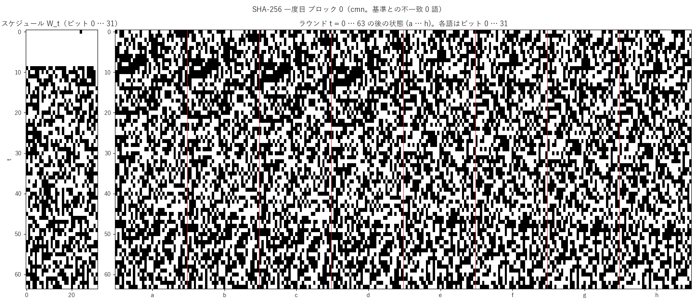
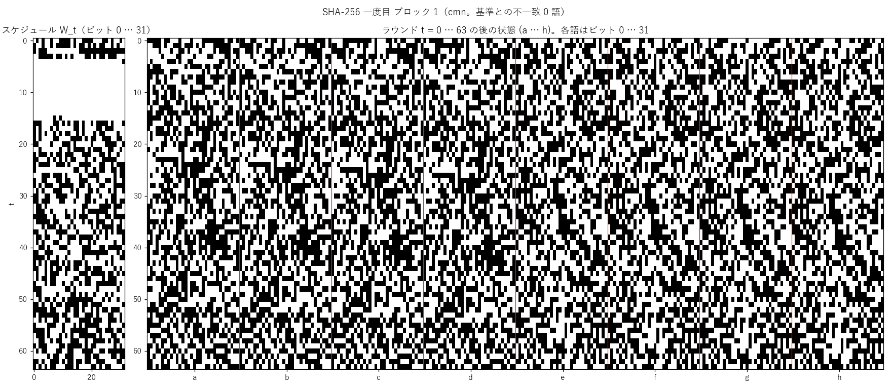
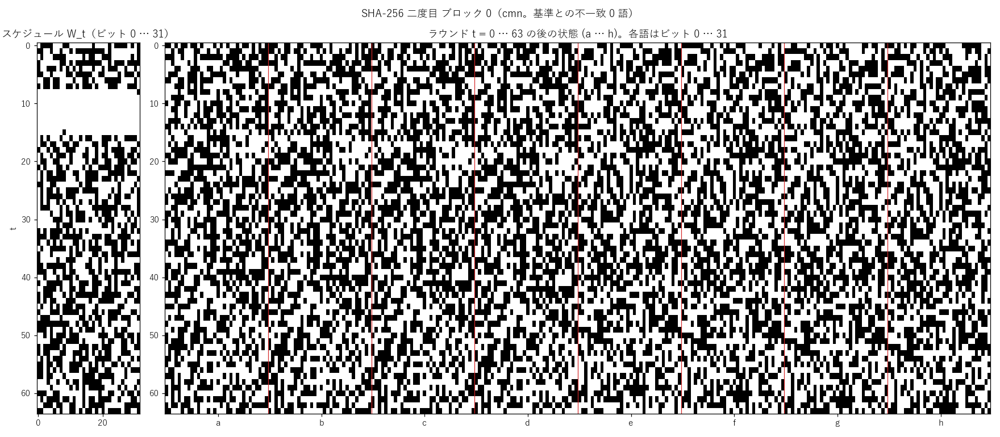

# Bitcoin のジェネシスブロックの検算

ヘッダ（80 byte）: `0100000000000000000000000000000000000000000000000000000000000000000000003ba3edfd7a7b12b27ac72c3e67768f617fc81bc3888a51323a9fb8aa4b1e5e4a29ab5f49ffff001d1dac2b7c`

| 項目 | 値 |
|---|---|
| cmn の SHA-256d（byte を逆順に表示） | `000000000019d6689c085ae165831e934ff763ae46a2a6c172b3f1b60a8ce26f` |
| 公表されているブロックのハッシュ | `000000000019d6689c085ae165831e934ff763ae46a2a6c172b3f1b60a8ce26f` |
| hashlib の SHA-256d との一致 | 一致 |
| 公表値との一致 | 一致 |
| 難しさの目標 bits = 0x1d00ffff、ハッシュ ≤ 目標 | 満たす |
| 圧縮の数（一度目 2 ブロック、二度目 1）| 3 |
| スケジュール W と途中の状態の、基準との不一致の語 | 0 / 1728 |

## 途中の状態

圧縮ごとに、スケジュール W の 64 語と、ラウンドごとの状態 (a … h) をビットで描いた。

## 雑音の中で測る

途中の状態（256 ビットずつ）と出力を、256 量子ビットの移送の回路で測る。1 回路が 2 shot。

| 対象 | 雑音 | Counter の初期状態 | 回路 | 全 shot が一致した回路 | 不一致のビット |
|---|---|---|---:|---:|---:|
| 出力 | なし | なし | 1 | 1 | 0 |
| 出力 | あり | なし | 1 | 1 | 0 |
| 出力 | なし | あり | 1 | 1 | 0 |
| 出力 | あり | あり | 1 | 1 | 0 |
| SHA-256 一度目 ブロック 0: ラウンドの状態 64 個 | あり | あり | 64 | 64 | 0 |
| SHA-256 一度目 ブロック 0: スケジュール W 8 区間 | あり | あり | 8 | 8 | 0 |
| SHA-256 一度目 ブロック 1: ラウンドの状態 64 個 | あり | あり | 64 | 64 | 0 |
| SHA-256 一度目 ブロック 1: スケジュール W 8 区間 | あり | あり | 8 | 8 | 0 |
| SHA-256 二度目 ブロック 0: ラウンドの状態 64 個 | あり | あり | 64 | 64 | 0 |
| SHA-256 二度目 ブロック 0: スケジュール W 8 区間 | あり | あり | 8 | 8 | 0 |

